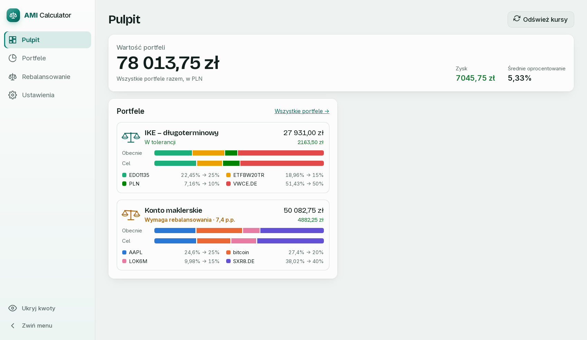
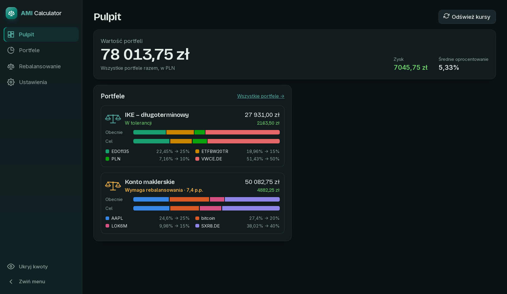
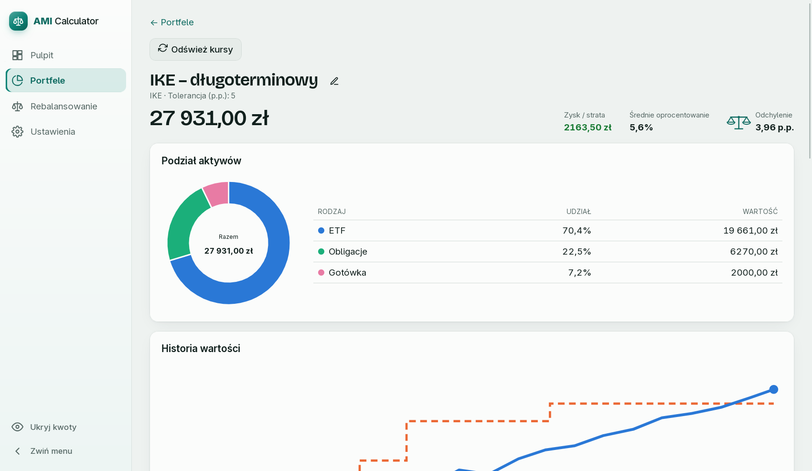
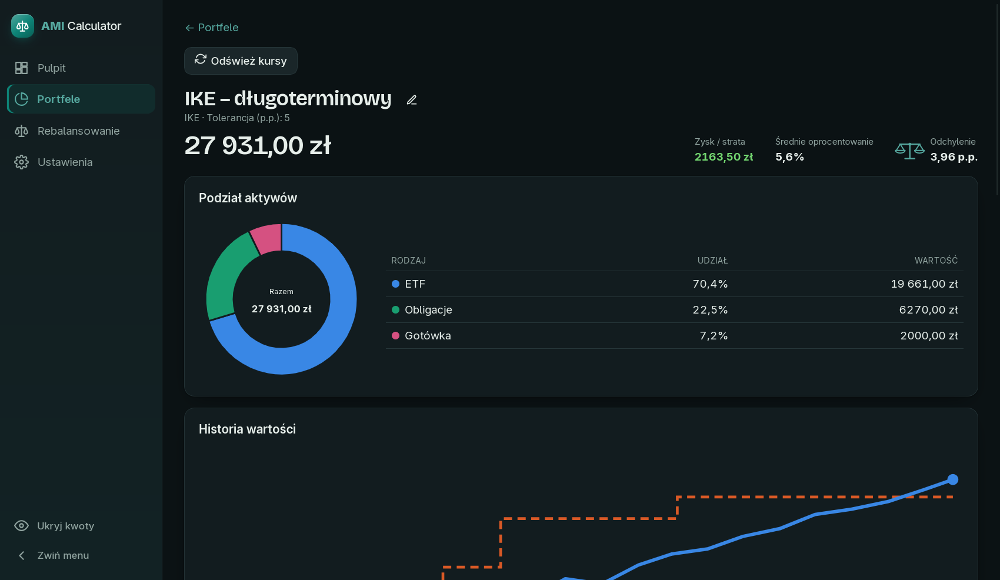
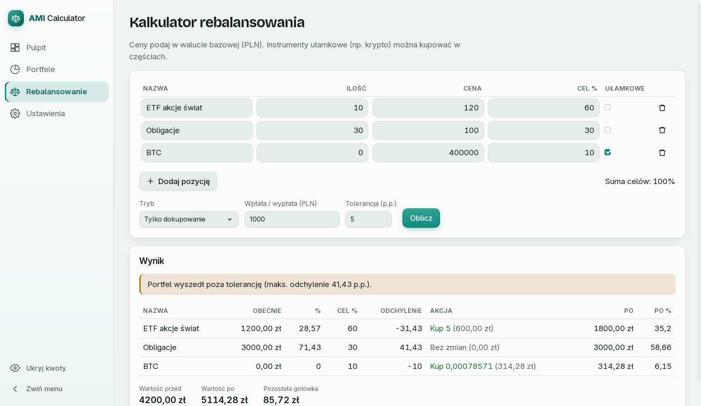
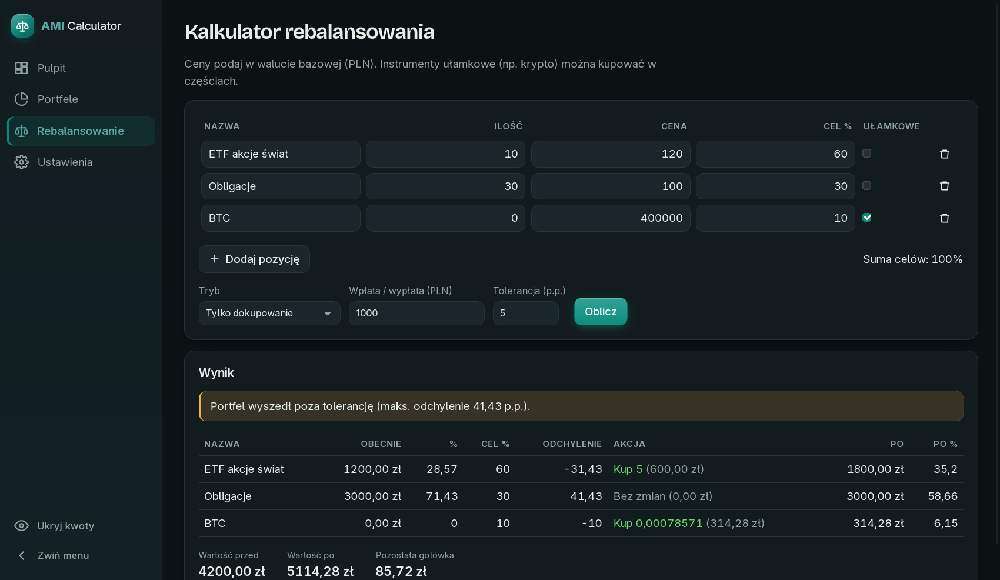

# AMI Calculator

Kalkulator rebalansowania portfela inwestycyjnego. Działa na komputerze (Windows, Linux, macOS) i na Androidzie, a dane trzymasz u siebie: bez konta, bez chmury, bez reklam.

*English: a local-first portfolio rebalancing calculator (Tauri 2, Rust, Svelte). Your data stays on your device. The interface is available in Polish, English, German, Spanish, French and Ukrainian.*

| Jasny motyw | Ciemny motyw |
|---|---|
|  |  |
|  |  |
|  |  |

Dane na zrzutach są wymyślone.

## Co potrafi

- **Portfele** z instrumentami (ETF-y, akcje z GPW i z zagranicy, obligacje skarbowe, krypto, gotówka, lokaty), transakcjami kupna i sprzedaży, średnią ceną zakupu i zyskiem.
- **Rebalansowanie** do zadanej alokacji: tylko dokupowanie albo pełne, z tolerancją odchylenia. Dla rachunków zwykłych pokazuje **szacowany podatek Belki** od sprzedaży (IKE i IKZE: 0).
- **Kursy online**: NBP (waluty), Yahoo Finance (GPW i giełdy zagraniczne), CoinGecko (krypto). Ceny można też wpisać ręcznie.
- **Obligacje skarbowe**: po wyborze serii aplikacja podpowiada oprocentowanie pierwszego okresu z oficjalnej oferty Ministerstwa Finansów, liczy datę wykupu i czas do niej.
- **Pulpit i wykresy**: wartość i zysk wszystkich portfeli, podział aktywów, historia wartości z linią wpłat, średnie oprocentowanie ważone wartością.
- **Kopia i synchronizacja bez serwera**: wszystko w jednym pliku `.ami` (JSON). Plik możesz trzymać w folderze, który synchronizujesz własną usługą (Syncthing, Dysk Google, OneDrive, Nextcloud), i opcjonalnie zaszyfrować hasłem (Argon2id + XChaCha20-Poly1305).
- **Personalizacja**: motyw jasny, ciemny i systemowy, kolor akcentu, gęstość, skala i rozmiar tekstu, zaokrąglenia, czcionka, paleta dla daltonistów, tryb prywatny (ukrywa kwoty), konfigurowalny pulpit.
- **Języki**: polski, English, Deutsch, Español, Français, Українська. Tłumaczenia poza polskim i angielskim zrobił model AI i nie sprawdził ich native speaker, więc błędy są możliwe.

> **To nie jest porada inwestycyjna ani podatkowa.** Podatek to szacunek według średniej ceny zakupu (urząd skarbowy liczy metodą FIFO), bez opłat od sprzedaży i strat z poprzednich lat, więc może się różnić od PIT-38. Kursy z Yahoo Finance pochodzą z nieoficjalnego API i mogą przestać działać. Sprawdzaj wyniki, zanim złożysz zlecenie.

## Pobieranie

Gotowe instalatory są w [wydaniach](../../releases). Aplikacja **nie jest podpisana** płatnym certyfikatem, więc system pokaże ostrzeżenie przy pierwszym uruchomieniu.

- **Windows**: `AMI_Calculator_*_x64-setup.exe`. Jeśli pojawi się „System Windows ochronił ten komputer”, kliknij *Więcej informacji → Uruchom mimo to*. Plik `.msi` instaluje dla wszystkich użytkowników komputera; nie instaluj go na maszynie, na której jest już wersja z `.exe`.
- **Linux**: `.AppImage` (`chmod +x`, uruchom), `.deb` (`sudo apt install ./plik.deb`) albo `.rpm` (`sudo dnf install ./plik.rpm`).
- **macOS**: `.dmg` (Intel i Apple Silicon). Aplikacja nie jest podpisana ani notaryzowana przez Apple, więc przy pierwszym uruchomieniu kliknij ją prawym przyciskiem → *Otwórz*. Jeśli system pisze, że plik jest uszkodzony, zdejmij oznaczenie pobrania: `xattr -dr com.apple.quarantine /Applications/AMI_Calculator.app`. Wersja na macOS jest **nowa i niesprawdzona na prawdziwym komputerze**.
- **Android** (arm64): `AMI_Calculator_*_arm64.apk`. Telefon poprosi o zgodę na instalację z nieznanych źródeł. Aktualizacje instalują się nad starą wersją, bo wszystkie APK są podpisane tym samym kluczem.

Aplikacja sprawdza nowe wersje tylko wtedy, gdy klikniesz „Sprawdź aktualizacje” w Ustawieniach. Sama nie łączy się z GitHubem.

## Prywatność

Dane (baza SQLite) leżą w katalogu danych aplikacji na Twoim urządzeniu. Aplikacja łączy się z internetem tylko po kursy: NBP, Yahoo Finance, CoinGecko i strona ofert obligacji obligacjeskarbowe.pl. Wysyła do nich symbole instrumentów, które śledzisz, i nic więcej. Nie ma kont, telemetrii ani analityki.

## Budowanie ze źródeł

Potrzebujesz Rusta (stable), Node.js LTS i [zależności systemowych Tauri](https://tauri.app/start/prerequisites/).

```sh
npm install
npm run tauri dev                    # aplikacja z odświeżaniem na żywo
npm run tauri build                  # instalatory dla Twojego systemu
cargo test --workspace               # testy logiki
cargo clippy --workspace --all-targets -- -D warnings
npm run check                        # typy frontendu
npm test                             # testy pomocniczych modułów TypeScript
```

Układ projektu:

```
crates/ami-core/   logika bez interfejsu: model, SQLite, rebalansowanie, kursy, szyfrowanie, synchronizacja
src-tauri/         aplikacja Tauri: komendy wywoływane z interfejsu, pobieranie kursów
src/               interfejs: SvelteKit (SPA), tłumaczenia w src/lib/i18n
scripts/           wydanie, podpis APK, testy pomocnicze
```

Kwoty to zawsze `rust_decimal` (w interfejsie ciągi znaków), nigdy liczby zmiennoprzecinkowe.

## Licencja i wkład

Kod jest publiczny do wglądu, ale **wszystkie prawa są zastrzeżone**: patrz [LICENSE](LICENSE). Nie przyjmuję pull requestów, ale zgłoszenia błędów w [Issues](../../issues) są mile widziane. Zgłoszenia dotyczące bezpieczeństwa: [SECURITY.md](SECURITY.md).

Nagłówki używają czcionki Bricolage Grotesque (SIL Open Font License, dołączona do aplikacji). Reszta tekstu to czcionka systemowa (Inter, jeśli jest zainstalowana, więc zrzuty ekranu mogą wyglądać inaczej niż u Ciebie).
